# CtrlFind

CtrlFind takes a programming problem written in English and searches for the Python code most likely to solve it. It starts with semantic search, then runs the strongest candidates against an example from the problem statement to check whether their output matches.

The project focuses on code retrieval, not code generation. It uses a small embedding model and local execution rather than a generative model or a hosted AI API. CtrlFind is still being developed; the results below distinguish the frozen benchmark baseline from later experiments on training data.

## The problem

Searching code by keywords works poorly when the question and the implementation use different words. A problem might describe a game, a route, or a sequence of operations, while the solution is mostly loops, arithmetic, and data structures. The right code can look less similar to the description than an unrelated snippet.

The task is to take a natural-language query and rank a large collection of code snippets so that the relevant ones appear first. A useful retrieval system also has to keep working as code changes.

CtrlFind addresses three related problems:

- **Retrieval accuracy (P0).** Find the relevant code and put it as high in the results as possible.
- **Retrieval across versions (P1).** Search a particular version of a code collection without rebuilding everything from scratch after every change.
- **Evolutionary retrieval.** Search several versions together and distinguish very similar implementations, including working code and versions with small bugs.

The original task is about retrieval. Generating a written answer or explaining the retrieved code is outside its scope.

## The approach

A similarity score is useful for finding candidates, but it does not tell us whether a program solves the problem. Two programs can look almost identical and behave differently because of one operator. Two correct programs can also look very different.

CtrlFind combines two signals. An embedding model first finds code that appears related to the question. Then, where the problem includes a usable input-output example, CtrlFind executes those candidates and checks the result. A candidate that passes the example receives priority, while semantic similarity still determines the order within each group.

Passing one example is evidence, not proof of correctness. An unrelated program can print the expected answer by accident, and a correct program can produce a different valid output. The verifier is deliberately conservative about what counts as a match.

## How CtrlFind works

### Semantic retrieval

CtrlFind uses [E5-base-v2](https://huggingface.co/intfloat/e5-base-v2) to turn the query and Python snippets into vector embeddings. Cosine similarity gives an initial ranking, and the current retrieval configuration keeps the top 50 candidates for verification.

The code embeddings are reused across queries. This first pass is important because execution can only help a correct snippet that made it into the candidate set.

### Execution verification

When the problem statement includes a supported example format, CtrlFind extracts the input and expected output. Each shortlisted program runs in a separate Python subprocess with a temporary working directory and a one-second timeout.

A program counts as passing only if it finishes with exit code 0 and produces the expected output. The verifier normally uses exact comparison. It can ignore trailing spaces and tabs on individual lines for narrowly identified, space-separated integer output; fixed-width and ambiguous layouts keep strict comparison.

Programs that crash, time out, or produce different output do not receive a verification promotion. The current default checks the first usable published example, not every possible input.

### Reranking

Candidates that pass verification move above candidates that do not. Within both groups, CtrlFind preserves their original semantic-similarity order.

It checks all selected candidates rather than stopping at the first match. This matters because unrelated programs sometimes share the same sample input format and produce the same small answer. Verification is a reranking signal, not a replacement for retrieval.

## System architecture

<!-- ARCHITECTURE SVG PLACEHOLDER
Create docs/architecture.svg and insert it here as:

Diagram type: component/data-flow overview.
Visual style: transparent background, white text, arrows, and box outlines; no accent colours.
Show the natural-language query, E5 embedding and index, top-K retrieval, example extraction,
candidate subprocess execution, output verification, reranking, ranked snippets,
content-addressed version store, embedding cache, and verdict/checkpoint caches.
Do not add components that are not implemented.
-->

The main path is query → embedding search → top-K candidates → example-based verification → ranked snippets. A versioned snippet store supplies the searchable code, while embedding and verification caches avoid repeating work when their inputs have not changed. The MTEB integration runs this same retrieval and reranking logic during evaluation.

## Retrieval across versions

The CoIR APPS corpus is a snapshot, so CtrlFind uses a generated three-version history to exercise version-aware retrieval. These are synthetic changes, not an imported Git history from a real software repository.

| Version | Changes |
|---|---|
| `v1` | Original snippets. |
| `v2` | Some snippets are reformatted; some receive a small injected bug. |
| `v3` | Some bugs are fixed, others introduced, with additional formatting changes. |

### Content-addressed storage

Each distinct snippet is stored under a hash of its content. A version maps document IDs to those stored contents. If identical code appears in several versions, it needs only one stored copy and one embedding.

This also gives the cache a useful identity: a changed snippet has a different content hash, so its old embedding or execution verdict should not be silently reused for the new code.

### Incremental indexing

When a new version is created, unchanged snippets reuse existing embeddings. Only new or modified content needs to be encoded. The amount of re-indexing therefore depends on what changed, rather than automatically processing the whole collection again.

The repository includes simulated-change and version-comparison tooling. Historical indexing timings appear under **Performance**; those measurements used a T4 GPU and should not be mistaken for CPU-only indexing results.

## Evolutionary retrieval

CtrlFind can search the combined pool of versions. Identical snippets are deduplicated, so they are embedded and verified once even if several versions reference them.

The difficult cases are snippets that differ by a single token. An embedding may give a working version and a buggy version nearly the same similarity score. If the example exposes the bug, execution separates them. If both happen to pass, their similarity order is preserved; a sample that misses the bug cannot establish which version is correct.

This version search has been tested on the generated history. The number of contested cases remains small, so the results are evidence for that experiment, not a general claim about real repository histories.

## Evaluation and results

### Dataset and evaluation metrics

The main benchmark is [CoIR AppsRetrieval](https://huggingface.co/datasets/CoIR-Retrieval/apps), built from programming problems and Python solutions in APPS. Its evaluated test split contains **3,765 queries** and a corpus of **8,765 snippets**. CtrlFind uses [MTEB](https://docs.mteb.org/) for scoring.

- **NDCG@10** rewards placing relevant results near the top of the first ten results.
- **MRR@10** measures how early the first relevant result appears within the first ten.
- **Recall@K** tells us whether the relevant snippet was retrieved among the first K candidates, before verification has a chance to help.

The published test result has been frozen. Subsequent verifier experiments use training queries; their scores are not presented as updated test-set results.

### Baseline and comparisons

The following numbers are for AppsRetrieval and use NDCG@10 on a 0–100 scale. The reference-model rows come from the [CoIR paper](https://aclanthology.org/2025.acl-long.1072/); the CtrlFind row is the repository's frozen result.

| Model | Size | NDCG@10 |
|---|---:|---:|
| BM25 | — | 0.95 |
| UniXcoder | 123M | 1.36 |
| E5-base | 110M | 11.52 |
| **E5-base + execution verification (CtrlFind)** | **110M** | **19.96** |
| E5-Mistral | 7B | 21.33 |
| Voyage-Code-002 | API | 26.52 |

These are benchmark comparisons, not claims of equal compute, model access, or inference cost. The E5-base retrieval baseline matches the paper's reported 11.52.

### Retrieval results

| Metric | E5-base retrieval | CtrlFind frozen baseline |
|---|---:|---:|
| NDCG@10 | 11.52 | **19.96** |
| MRR@10 | 9.88 | **19.05** |

In the original 3,765-query evaluation, verification improved the ranking for **420** queries, worsened it for **10**, and left **3,335** unchanged.

The frozen result is saved in [`artifacts/baseline_frozen.json`](artifacts/baseline_frozen.json). It predates the later execution-correctness changes, so **19.96 / 19.05 are not claimed as final scores for the current working implementation**.

### Version retrieval results

An earlier experiment searched the three synthetic versions together: **10,819 distinct snippet contents** across **191 problems** with usable examples. Only **22** of those problems had a buggy version competing in the top 50.

| Ranking method | Working version first (22 contested problems) | NDCG@10 (191 problems) |
|---|---:|---:|
| Similarity only | 72.7% | 11.88 |
| Similarity, newest version preferred | 68.2% | 11.83 |
| Similarity + execution | **100%** | **23.03** |

The 100% figure means **22 out of 22 contested cases**, not 191 out of 191. Also, NDCG@10 measures the full retrieval improvement, not just how well the system chooses between versions. A larger version experiment is still needed.

## Performance

Execution is the expensive part of the current pipeline. Embedding lookup and cosine ranking are much cheaper than starting and running dozens of Python programs.

| Measurement | Observed result | Conditions |
|---|---|---|
| Execute 50 candidates | About 3.6 s per query | Earlier run, two CPU cores |
| Execute 50 candidates | 2.94 s median; 4.14 s p95 | Later 40-query training replay |
| Full index build | 128 s | Historical T4 GPU measurement |
| Incremental build, `v1` → `v2` | 20 s for 1,353 changed snippets | Historical T4 GPU measurement |
| Incremental build, `v2` → `v3` | 11 s for 701 changed snippets | Historical T4 GPU measurement |

The execution measurements come from different runs and should not be read as a controlled speedup. The next performance work targets subprocess overhead, caching, and candidate handling, with correctness checked before accepting an optimization. The intended retrieval and verification runtime is CPU-based; the historical T4 figures describe indexing experiments only.

## Research and experiments

The project keeps its experiment history in [`docs/research-log.md`](docs/research-log.md), including approaches that were tested and rejected.

Several findings have already changed the verifier:

- **Exit status matters.** A program can print the expected answer and then crash. Matching stdout alone was giving those programs credit; verification now requires a successful exit.
- **Output formatting needs care.** Narrow trailing-whitespace normalization recovered some valid outputs. Broad normalization was rejected because it can accept incorrectly formatted fixed-width output.
- **More examples are not automatically better.** Requiring two examples removed false promotions but also removed too many correct ones, reducing ranking accuracy on a fixed training sample.
- **More parsing is not automatically safer.** Expanded example extraction found additional correct matches, but it also created additional incorrect promotions. That experimental parser was not retained.

In the latest training audit, the retained verifier passed **394/511 (77.10%)** gold snippets with parseable examples, while **2/2,555 (0.0783%)** sampled unrelated snippets passed. Repeated runs varied slightly because some programs are nondeterministic or close to the timeout. These are verification-audit figures, not AppsRetrieval test NDCG or MRR results, and the unrelated snippets are not representative of every retrieved candidate.

## Tech stack

| Area | Technology |
|---|---|
| Language | Python |
| Embedding model | E5-base-v2 |
| Embedding inference | Sentence Transformers, PyTorch |
| Dataset handling | Hugging Face Datasets |
| Vector ranking | NumPy, cosine similarity |
| Retrieval evaluation | MTEB |
| Execution checking | Python subprocesses, temporary directories |
| Interactive interface | Gradio |
| Versioning and caching | Content hashes, local cached artifacts |
| Packaging | Docker |

The retrieval pipeline does not call a generative LLM or require an external model API key.

## Testing and reproducibility

The frozen benchmark result is kept separately from experimental training runs. Research scripts and audit artifacts record the candidate samples, settings, and observed verification outcomes, while [`docs/research-log.md`](docs/research-log.md) explains why changes were retained or reverted.

The latest verification review reported **21 passing regression tests**, covering crashes after matching output, timeouts, output comparison, cache identity, checkpoint recovery, and version-related behavior. A 40-query replay returned identical rankings from cold and warm checkpoints; the warm run executed no candidates.

These checks establish the reviewed verifier behavior on the tested cases. They do not make a one-example execution check a complete correctness proof, and the final test-set evaluation has not yet been rerun with the retained changes.

## Limitations and future work

- **First-stage recall is the main ceiling.** In the earlier analysis, the relevant snippet reached the top 50 for roughly 31% of queries. Verification cannot recover snippets that were never retrieved.
- **Example coverage is limited.** The retained parser extracted a usable example for **511/5,000 training problems (10.22%)** in the audit. Earlier notebook figures used a different split and parsing method, so they are not interchangeable.
- **One example is weak evidence.** Incorrect programs can pass by coincidence, and correct programs can emit different valid outputs. General-purpose checking cannot resolve every problem-specific output rule safely.
- **Execution can be unstable.** CPU contention, timeouts, and randomized programs can change a verdict between runs. Some transient timeout failures can remain cached.
- **Executing arbitrary code is risky.** A subprocess timeout and temporary directory are not a hardened sandbox. Docker helps isolate environments, but the execution system still needs stronger controls before handling untrusted code in a publicly accessible service.
- **Version evaluation is synthetic.** The current history is generated from a static dataset. Real Git histories and a larger contested-version sample have not yet been validated.
- **Generalization is unproven.** The current system targets Python programming-problem solutions; its performance on large, mixed-language software repositories has not been established.

The remaining work is to improve execution speed without changing verdicts, raise first-stage retrieval coverage, strengthen version experiments, and repeat the final benchmark under a documented configuration.

## References

### Research papers

| Paper | Link |
|---|---|
| CoIR: A Comprehensive Benchmark for Code Information Retrieval Models (ACL 2025) | [Paper](https://aclanthology.org/2025.acl-long.1072/) |
| Measuring Coding Challenge Competence With APPS (2021) | [Paper](https://arxiv.org/abs/2105.09938) |
| MTEB: Massive Text Embedding Benchmark | [Paper](https://arxiv.org/abs/2210.07316) |
| Text Embeddings by Weakly-Supervised Contrastive Pre-training (E5) | [Paper](https://arxiv.org/abs/2212.03533) |
| CodeSearchNet Challenge: Evaluating the State of Semantic Code Search | [Paper](https://arxiv.org/abs/1909.09436) |

### Datasets, models and documentation

| Resource | Link |
|---|---|
| CoIR benchmark | [GitHub](https://github.com/CoIR-team/coir) |
| CoIR AppsRetrieval dataset | [Hugging Face](https://huggingface.co/datasets/CoIR-Retrieval/apps) |
| Original APPS dataset | [GitHub](https://github.com/hendrycks/apps) |
| E5-base-v2 model | [Hugging Face](https://huggingface.co/intfloat/e5-base-v2) |
| CodeSearchNet dataset and tools | [GitHub](https://github.com/github/CodeSearchNet) |
| MTEB | [Documentation](https://docs.mteb.org/) |
| Sentence Transformers | [Documentation](https://www.sbert.net/) |